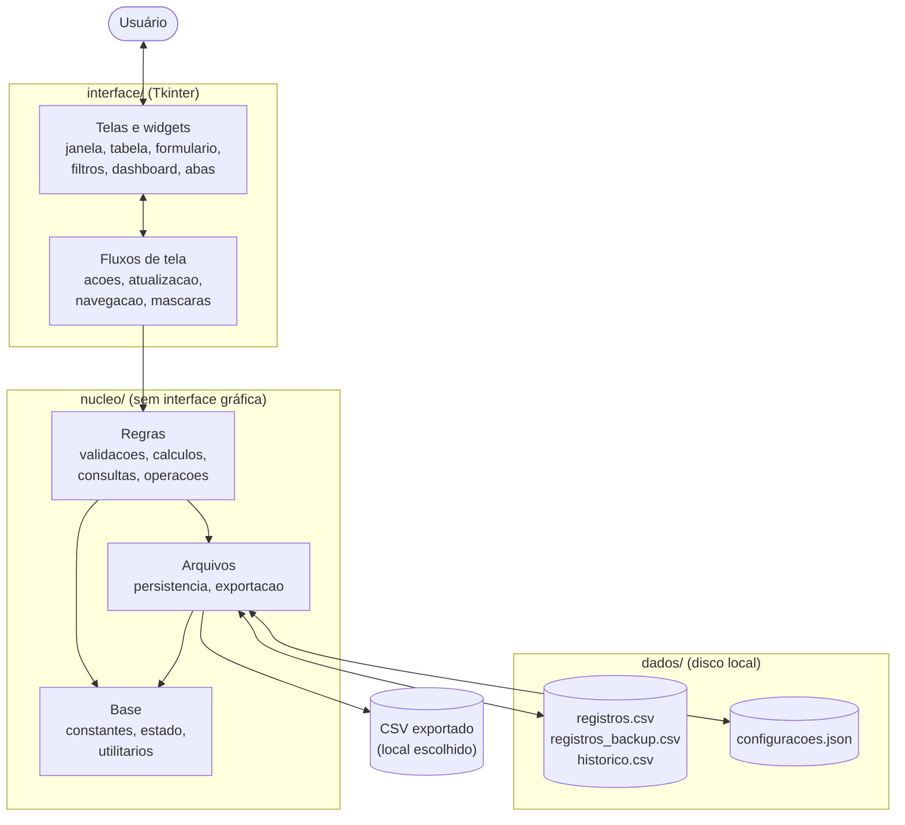
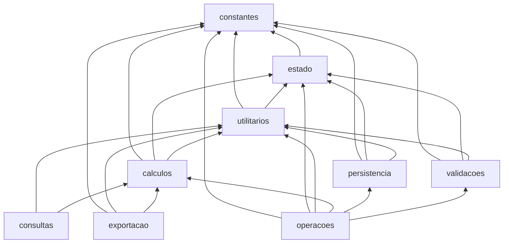
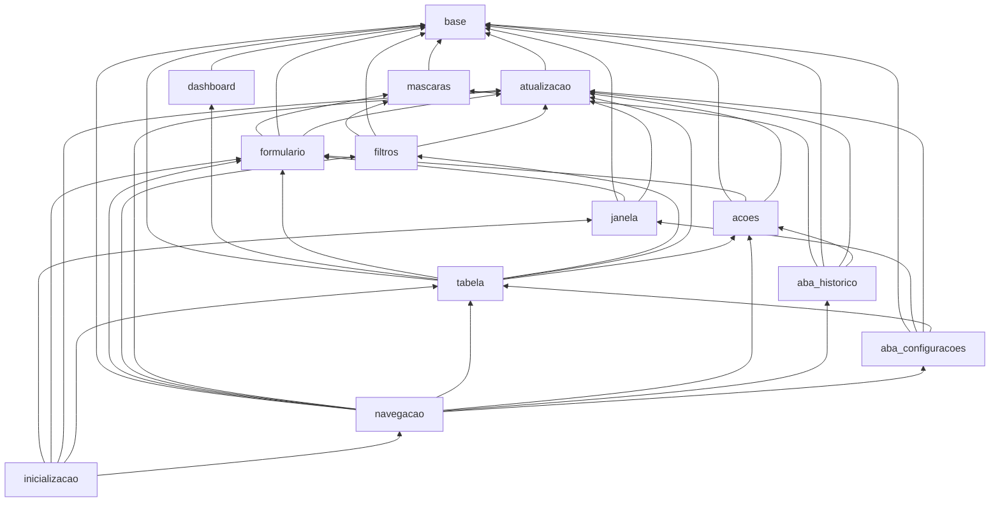
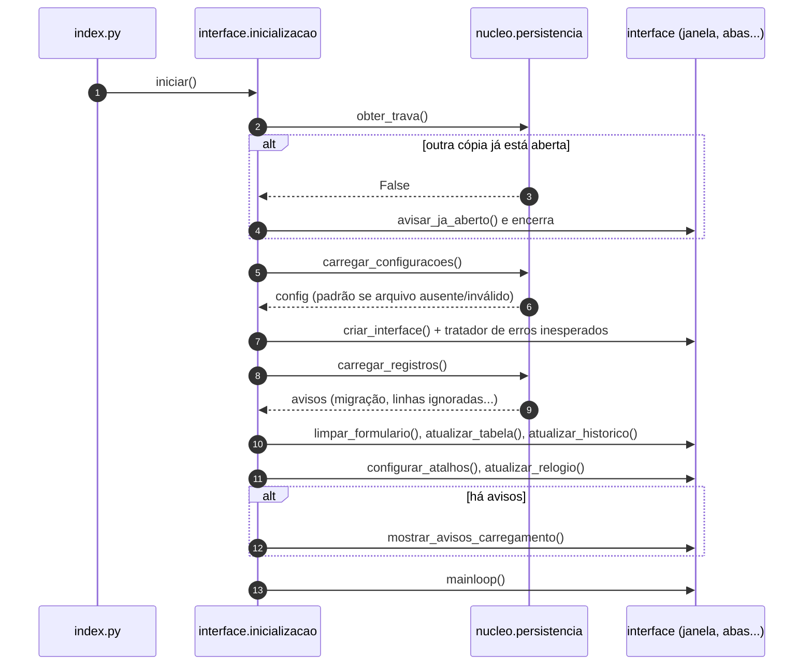
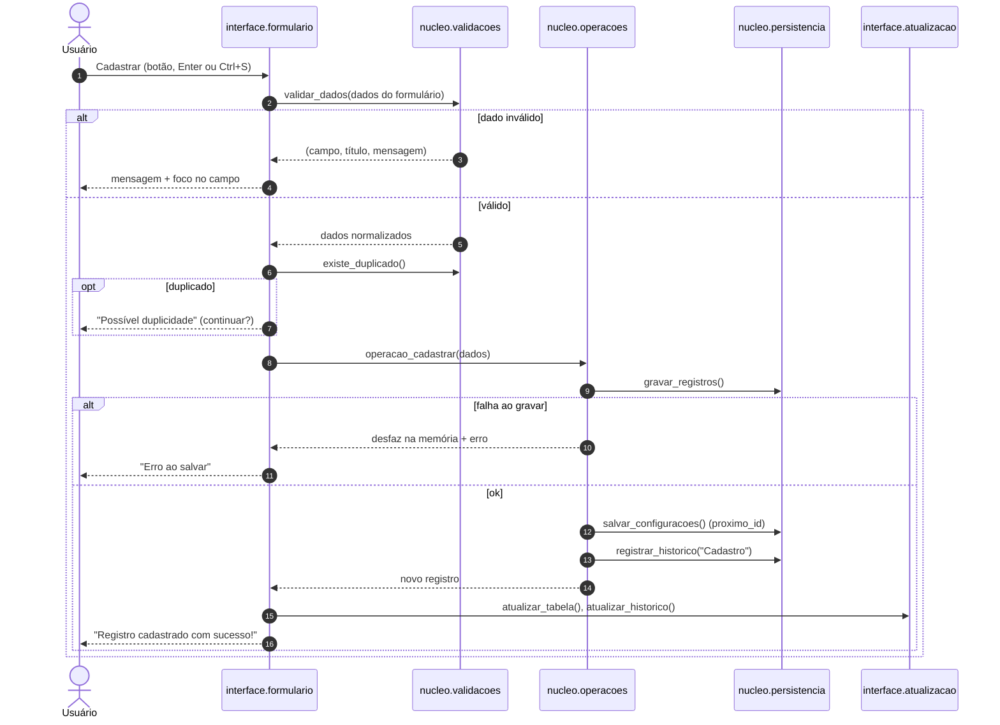
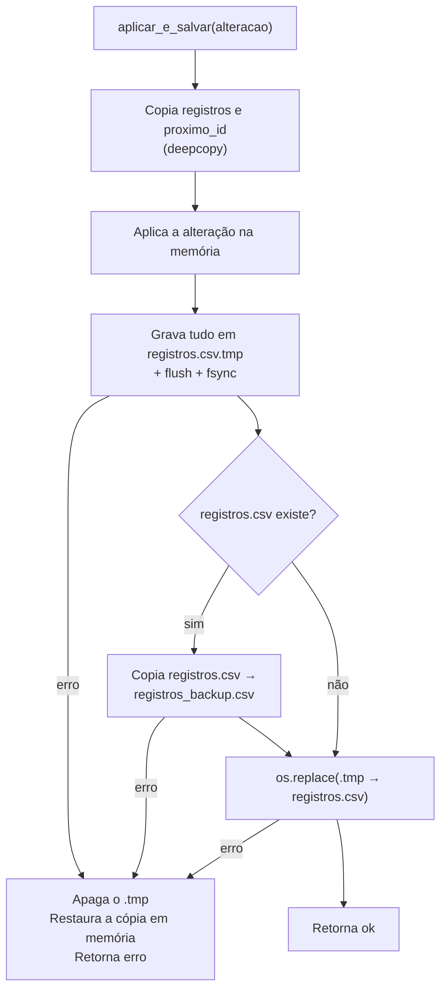
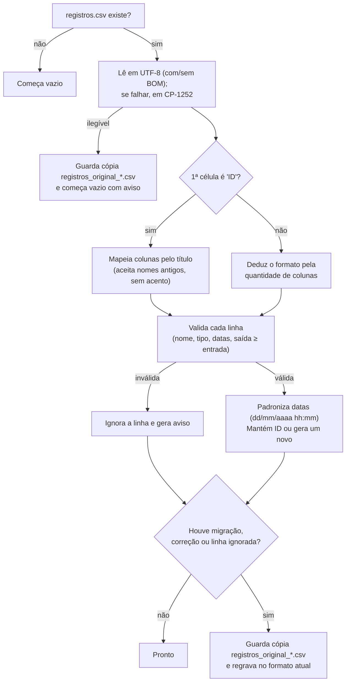

# Documentação Técnica

Este documento descreve como o **Cadastro de Portaria** está organizado por
dentro: arquitetura, responsabilidades de cada módulo, fluxo dos dados e
tecnologias. As regras de validação e cálculo estão detalhadas em
[Regras de negócio](regras_de_negocio.md), e os arquivos de dados em
[Instalação e manutenção](instalacao_e_manutencao.md#4-localização-dos-arquivos).

> Os diagramas usam [Mermaid](https://mermaid.js.org/), que é exibido
> automaticamente no GitHub e no VS Code (com a extensão de pré-visualização
> de Markdown com suporte a Mermaid).

## Sumário

1. [Tecnologias utilizadas](#1-tecnologias-utilizadas)
2. [Visão geral da arquitetura](#2-visão-geral-da-arquitetura)
3. [Estrutura de pastas](#3-estrutura-de-pastas)
4. [Camada `nucleo/`](#4-camada-nucleo)
5. [Camada `interface/`](#5-camada-interface)
6. [Dependências entre módulos](#6-dependências-entre-módulos)
7. [Estado compartilhado](#7-estado-compartilhado)
8. [Fluxo de dados](#8-fluxo-de-dados)
9. [Modelo de dados](#9-modelo-de-dados)
10. [Decisões de projeto](#10-decisões-de-projeto)

---

## 1. Tecnologias utilizadas

O sistema usa **apenas a biblioteca padrão do Python**. Não há dependências
externas nem arquivo `requirements.txt`.

| Tecnologia | Uso no projeto |
|------------|----------------|
| Python 3 (testado no 3.14) | Linguagem do sistema. |
| `tkinter` / `tkinter.ttk` | Interface gráfica: janelas, abas, tabela (`Treeview`), listas (`Combobox`), menus e caixas de diálogo. |
| `csv` | Leitura e gravação de `registros.csv`, `historico.csv` e das exportações (separador `;`). |
| `json` | Leitura e gravação de `configuracoes.json`. |
| `datetime` | Datas de entrada e saída, cálculo de permanência e períodos de filtro. |
| `re` | Expressões regulares para nome, placa e limpeza de texto. |
| `unicodedata` | Remoção de acentos para pesquisa e ordenação. |
| `os` | Caminhos, substituição atômica de arquivos (`os.replace`), `fsync` e abertura da pasta no Windows (`os.startfile`). |
| `msvcrt` (Windows) / `fcntl` (Linux, macOS) | Trava de arquivo que impede duas cópias abertas ao mesmo tempo. |
| `traceback`, `sys` | Exibição e registro, no terminal, de erros inesperados da interface. |
| `unittest`, `unittest.mock`, `tempfile` | Testes automatizados do núcleo, em [`testes/`](../testes/test_nucleo.py). |
| `copy` | Cópia dos registros em memória para desfazer alterações que não puderam ser salvas. |
| `types.SimpleNamespace` | Agrupamento do estado do programa e das referências aos widgets. |

Armazenamento: arquivos locais **CSV (UTF-8 com BOM)** e **JSON**. Não há
banco de dados nem acesso à rede.

## 2. Visão geral da arquitetura

O código é dividido em **duas camadas**:

- **`nucleo/`**: dados, regras, validações, cálculos e arquivos. **Não
  importa Tkinter**, então pode ser usado e testado sem abrir janelas.
- **`interface/`**: telas em Tkinter. Lê o que o usuário digitou, chama as
  funções do núcleo e atualiza o que aparece na tela.



O ponto de entrada é [`index.py`](../index.py), que apenas chama
`interface.inicializacao.iniciar()`.

## 3. Estrutura de pastas

```
Portaria/
├── index.py              Ponto de entrada
├── nucleo/               Lógica e arquivos (9 módulos)
├── interface/            Telas Tkinter (13 módulos)
├── testes/
│   └── test_nucleo.py    Testes automatizados do núcleo (unittest)
├── dados/                Arquivos de dados (criada automaticamente; fora do Git)
├── docs/                 Esta documentação
├── .gitignore            Impede versionar dados/ e arquivos gerados
└── _backup/
    └── index_antigo.py   Versão anterior, em arquivo único (não é usada)
```

O arquivo [`_backup/index_antigo.py`](../_backup/index_antigo.py) guarda a
versão anterior do sistema, escrita em um único arquivo. Ele **não é
importado** por nenhum módulo atual e serve apenas como referência
histórica.

## 4. Camada `nucleo/`

| Módulo | Responsabilidade | Principais funções e dados |
|--------|------------------|----------------------------|
| [`constantes.py`](../nucleo/constantes.py) | Valores fixos do sistema. | `VERSAO`, nomes de arquivos, `PASTA_DADOS`, formatos de data, `TIPOS`, `MOTIVOS`, opções de filtro, `COLUNAS_CSV`, limites de tamanho (`MAX_*`), expressões regulares (`PADRAO_NOME`, `PADRAO_PLACA`), máscaras, `CONFIG_PADRAO`, `DDDS_VALIDOS`, `INICIO_FORMULA`, colunas da tabela, paletas de cores dos temas. |
| [`estado.py`](../nucleo/estado.py) | Estado compartilhado em memória. | `registros` (lista), `config` (dicionário), `S` (estado geral), `T` (widgets). Veja a [seção 7](#7-estado-compartilhado). |
| [`utilitarios.py`](../nucleo/utilitarios.py) | Funções auxiliares. | `caminho()` (cria `dados/` se faltar), `converter_data()`, `converter_data_simples()`, `remover_acentos()`, `formatar_id()`, `formatar_duracao()`, `formatar_placa()`, `limpar_espacos()`, `buscar_registro()`, `CHAVES_CABECALHO` (mapeia títulos de coluna antigos), `TIPOS_NORMALIZADOS` (corrige tipos sem acento). |
| [`calculos.py`](../nucleo/calculos.py) | Situação, permanência e alerta. Nada disso é gravado no CSV. | `calcular_situacao()`, `calcular_duracao()`, `calcular_permanencia()`, `excedeu_limite()`, `texto_situacao()`, `opcoes_filtro_situacao()`, `situacao_confere()`. |
| [`validacoes.py`](../nucleo/validacoes.py) | Validação de formato e regras semânticas dos dados digitados. | `validar_dados()` (valida e normaliza o formulário inteiro), `validar_nome()`, `validar_datas()`, `validar_telefone()`, `formatar_telefone()`, `existe_duplicado()`. |
| [`persistencia.py`](../nucleo/persistencia.py) | Leitura e gravação dos arquivos e trava de instância única. | `obter_trava()`, `carregar_configuracoes()`, `salvar_configuracoes()`, `carregar_registros()` (com migração de formatos antigos), `gravar_registros()` (gravação segura + backup), `preservar_original()`, `registrar_historico()`, `ler_historico()`, `filtrar_historico()`, `maior_id_historico()`. |
| [`operacoes.py`](../nucleo/operacoes.py) | Operações sobre registros, com desfazer automático se a gravação falhar. | `aplicar_e_salvar()`, `operacao_cadastrar()`, `operacao_editar()`, `operacao_registrar_saida()`, `operacao_excluir()`. |
| [`consultas.py`](../nucleo/consultas.py) | Pesquisa, filtros, ordenação e indicadores. | `filtrar_registros()`, `intervalo_periodo()`, `registro_no_intervalo()`, `criterios_padrao()`, `chave_ordenacao()`, `calcular_indicadores()`. |
| [`exportacao.py`](../nucleo/exportacao.py) | Montagem e gravação dos CSVs exportados. | `exportar_csv()`, `linhas_exportacao_registros()`, `linhas_exportacao_historico()`, `situacao_exportada()`, `proteger_excel()`, `eh_arquivo_do_sistema()`. |

As funções que dependem do momento atual aceitam parâmetros opcionais
(`agora_dt` ou `hoje`). Isso permite testá-las com uma data fixa. Veja os
[testes automatizados](casos_de_teste.md#14-testes-automatizados-do-núcleo).

## 5. Camada `interface/`

| Módulo | Responsabilidade |
|--------|------------------|
| [`inicializacao.py`](../interface/inicializacao.py) | `iniciar()`: carrega configurações, monta a interface, carrega registros, mostra avisos de carregamento e inicia o laço principal do Tkinter. |
| [`janela.py`](../interface/janela.py) | Janela principal, cabeçalho, barra de status, relógio (`atualizar_relogio()`, a cada 1 s), troca de tema e confirmação ao fechar. |
| [`base.py`](../interface/base.py) | Fábrica de widgets com tema (`criar_botao`, `criar_cartao`, `criar_campo_texto`...), registro de widgets para recolorir ao trocar o tema, estilos `ttk`, cores das linhas, mensagens na barra de status e navegação entre abas. |
| [`navegacao.py`](../interface/navegacao.py) | Criação das quatro abas e ligação dos atalhos de teclado. |
| [`tabela.py`](../interface/tabela.py) | Aba Portaria: tabela principal, painel "Registro selecionado", barra de ações, colunas opcionais e menu de contexto. |
| [`dashboard.py`](../interface/dashboard.py) | Painel de indicadores (três grupos). |
| [`filtros.py`](../interface/filtros.py) | Pesquisa, filtros básicos e avançados, botões Aplicar e Limpar filtros. |
| [`formulario.py`](../interface/formulario.py) | Janela modal de cadastro/edição, modos "Nova entrada" e "Editando", detecção de dados não salvos e fluxo de salvar. |
| [`mascaras.py`](../interface/mascaras.py) | Filtros de digitação (nome, cor, placa, texto livre) e máscaras numéricas (data/hora, data, telefone), com controle da posição do cursor. |
| [`atualizacao.py`](../interface/atualizacao.py) | Redesenho da tabela, atualização periódica dos tempos, indicadores, contagem, painel de detalhes, ordenação e histórico. |
| [`acoes.py`](../interface/acoes.py) | Fluxos de registrar saída, excluir e exportar (com diálogos de confirmação e de arquivo). |
| [`aba_historico.py`](../interface/aba_historico.py) | Aba Histórico: filtros e tabela de eventos. |
| [`aba_configuracoes.py`](../interface/aba_configuracoes.py) | Abas Configurações e Sobre / Ajuda. |

## 6. Dependências entre módulos

### Núcleo



### Interface (somente dependências entre módulos da interface)

Todos os módulos da interface também importam módulos do núcleo.



Não há importações circulares. O núcleo nunca importa a interface.

## 7. Estado compartilhado

Definido em [`nucleo/estado.py`](../nucleo/estado.py):

| Objeto | Tipo | Conteúdo |
|--------|------|----------|
| `registros` | `list[dict]` | Registros carregados do CSV. É sempre alterada no lugar (`append`, `registros[:] = ...`), para que todos os módulos vejam a mesma lista. |
| `config` | `dict` | Configurações em uso (mesmas chaves de `CONFIG_PADRAO`). |
| `S` | `SimpleNamespace` | Estado geral: `proximo_id`, `id_em_edicao` (`None` = cadastrando), coluna e sentido da ordenação, tema atual, flags de formulário e painéis abertos, `suspender_filtros` (evita redesenhar várias vezes durante mudanças em lote), contador do relógio, dia em que a tabela foi filtrada, `falha_historico` (evento do histórico não gravado, a avisar na tela) e `trava` (arquivo de trava mantido aberto). |
| `T` | `SimpleNamespace` | Referências aos widgets criados (janela, tabela, variáveis dos campos e filtros) e listas de widgets a recolorir ao trocar o tema. |

## 8. Fluxo de dados

### 8.1 Inicialização



### 8.2 Cadastro de uma entrada



Edição, registro de saída e exclusão seguem o mesmo padrão: a interface lê
a seleção, chama a função `operacao_*` correspondente, que grava o CSV e o
histórico, e depois a tela é redesenhada.

### 8.3 Gravação segura de `registros.csv`

Toda alteração passa por `aplicar_e_salvar()` (operacoes) e
`gravar_registros()` (persistencia):



Assim, o arquivo principal nunca fica gravado pela metade e a interface
nunca mostra dados que não foram salvos.

### 8.4 Atualização da tela

| Gatilho | O que é atualizado |
|---------|--------------------|
| Qualquer alteração de dados, filtro ou ordenação | `atualizar_tabela()`: refiltra, reordena e redesenha a tabela; atualiza indicadores, contagem e painel de detalhes. |
| A cada segundo | Relógio do cabeçalho. |
| A cada 60 segundos | `atualizar_tempos()`: atualiza Permanência, Situação e cores das linhas visíveis sem redesenhar a tabela. Redesenha tudo se o dia mudou (os filtros "Hoje" e "Ontem" mudam) ou se o filtro de situação é "No prazo"/"Excedido" (um registro pode ter mudado de grupo). |
| Troca para a aba Histórico, filtros do histórico, alterações de dados | `atualizar_historico()`: relê `historico.csv`, aplica os filtros da aba e, se algum evento não pôde ser gravado, avisa na barra de status. |

### 8.6 Tratamento de erros

| Situação | Tratamento |
|----------|------------|
| Falha ao gravar `registros.csv` | Operação desfeita na memória e mensagem "Erro ao salvar" (seção 8.3). |
| Falha ao gravar `configuracoes.json` | Mensagem; as configurações valem até fechar o programa. |
| Falha ao gravar `historico.csv` | A operação principal é mantida; aviso na barra de status. |
| Arquivo de registros ilegível ou com linhas inválidas | Avisos ao abrir e cópia do original (seção 8.5). |
| Exceção não prevista em um botão ou atalho | `mostrar_erro_inesperado()` exibe uma mensagem e imprime o rastreamento no terminal, em vez de falhar em silêncio. |
| Segunda cópia do programa | `obter_trava()` falha e a cópia é encerrada com aviso. A trava é do sistema operacional e é liberada mesmo se o programa travar. |

### 8.5 Carregamento e migração de `registros.csv`

`carregar_registros()` aceita o formato atual e formatos de versões
anteriores:



Detalhes das regras de migração estão em
[Regras de negócio](regras_de_negocio.md#9-regras-de-carregamento-do-arquivo).

## 9. Modelo de dados

### Registro (em memória)

| Chave | Tipo | Obrigatório | Coluna no CSV |
|-------|------|-------------|---------------|
| `id` | `int` | sim (automático) | ID |
| `nome` | `str` | sim | Nome |
| `tipo` | `str` | sim | Tipo de acesso |
| `entrada` | `str` `dd/mm/aaaa hh:mm` | sim | Entrada |
| `saida` | `str` (vazio = no local) | não | Saída |
| `telefone` | `str` `(DD) NNNNN-NNNN` | não | Telefone |
| `empresa` | `str` | não | Empresa |
| `visitado` | `str` | não | Pessoa visitada |
| `motivo` | `str` | não | Motivo |
| `observacoes` | `str` | não | Observações |
| `placa` | `str` sem hífen | não | Placa |
| `modelo` | `str` | não | Modelo |
| `cor` | `str` | não | Cor |

A ordem das colunas no arquivo é definida por `COLUNAS_CSV` em
[`constantes.py`](../nucleo/constantes.py). **Situação** e **Permanência**
não são armazenadas: são calculadas por [`calculos.py`](../nucleo/calculos.py)
sempre que necessário (tela e exportação).

### Evento do histórico

| Campo | Exemplo |
|-------|---------|
| Data/Hora | `29/10/2026 18:03:00` |
| Ação | `Cadastro`, `Edição`, `Saída`, `Exclusão`, `Exportação` ou `Configuração` |
| ID | ID do registro (vazio em Exportação e Configuração) |
| Nome | Nome da pessoa (vazio em Exportação e Configuração) |
| Descrição | Texto gerado pelo sistema, por exemplo `Campos alterados: Placa, Modelo, Cor` |

### Configurações

| Chave | Tipo | Padrão |
|-------|------|--------|
| `tema` | `"claro"` ou `"escuro"` | `"claro"` |
| `tempo_max_horas` | inteiro de 1 a 72 | `4` |
| `alerta_ativo` | booleano | `true` |
| `mostrar_motivo` | booleano | `true` |
| `mostrar_veiculo` | booleano | `false` |
| `proximo_id` | inteiro | `1` |

## 10. Decisões de projeto

| Decisão | Motivo |
|---------|--------|
| Somente biblioteca padrão | Executa em qualquer computador com Python, sem instalar pacotes. |
| Núcleo separado da interface | Regras testáveis sem abrir janelas; telas mais simples. |
| Valores calculados (situação, permanência) não gravados | Evita dados desatualizados ou inconsistentes no CSV. |
| Validação em duas etapas (formato e semântica) | Mostra ao usuário se o problema é o formato do texto ou o significado do dado. |
| Máscaras e filtros de digitação | Impedem boa parte dos erros antes da validação. |
| Gravação em arquivo temporário + `os.replace` | Evita arquivo corrompido em caso de falha durante a gravação. |
| Desfazer na memória se a gravação falhar | A tela sempre corresponde ao que está no disco. |
| IDs crescentes, nunca reaproveitados | Um ID identifica sempre a mesma pessoa no histórico. |
| CSV com `;` e UTF-8 com BOM | Abre corretamente no Excel em português, com acentos. |
| Histórico só acrescenta linhas | Exclusões não apagam a trilha de atividades. |
| Trava de arquivo do sistema operacional | Impede perda de dados por duas cópias abertas, sem risco de trava "presa" após uma queda. |
| Bloqueio de fórmulas na entrada **e** na exportação | Defesa em camadas contra injeção de CSV (veja [Regras de negócio](regras_de_negocio.md#35-proteção-contra-injeção-de-fórmulas-csv-injection)). |
| Testes automatizados só com `unittest` | Mantém o projeto sem dependências externas. |
