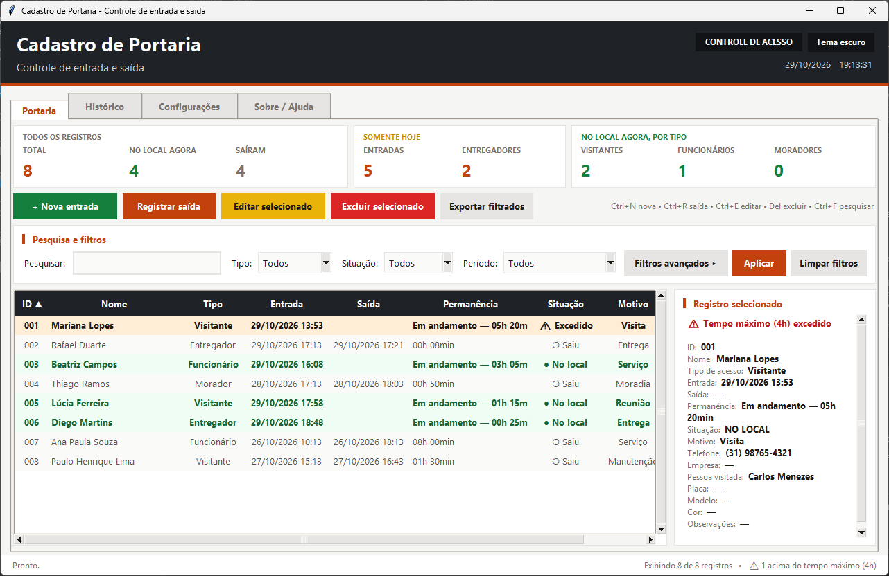
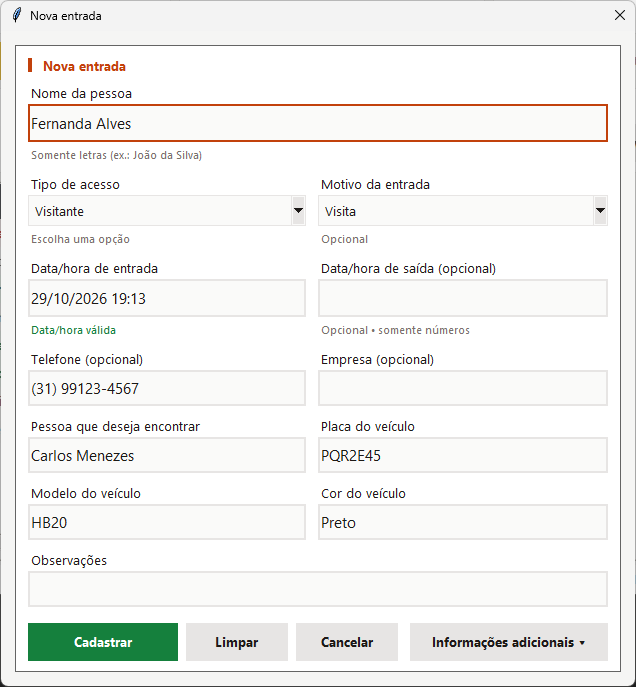
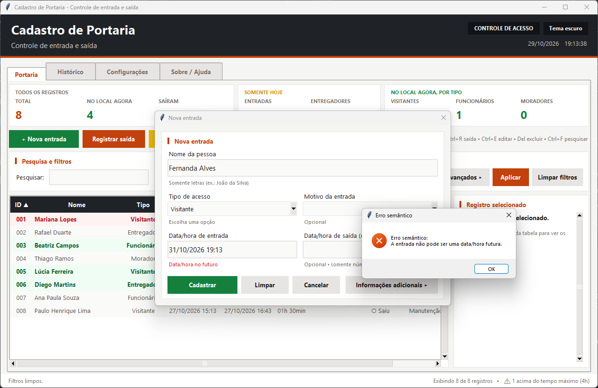
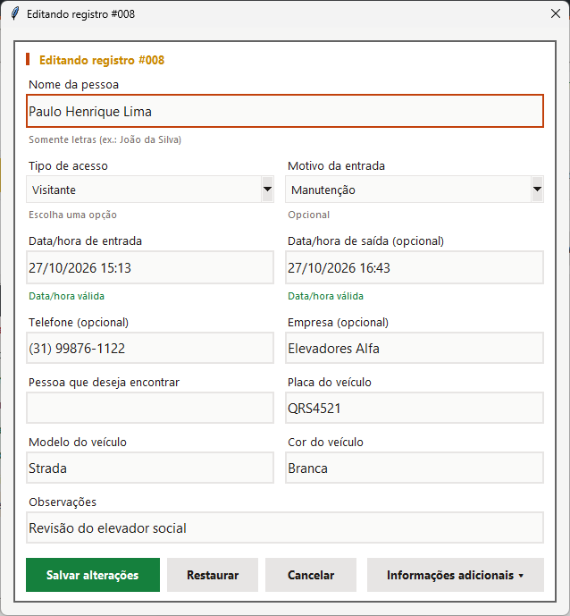
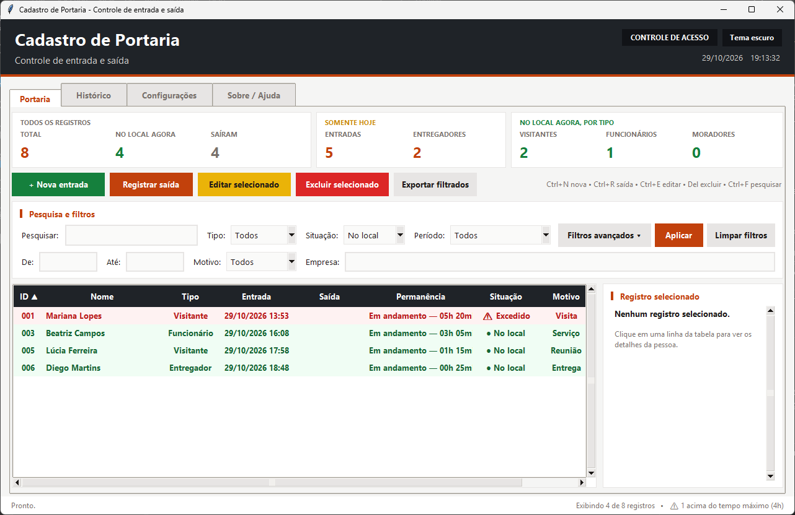
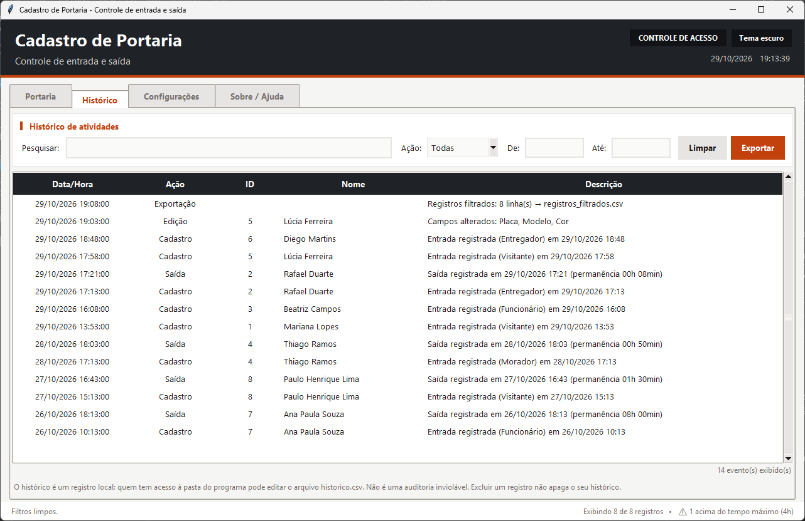
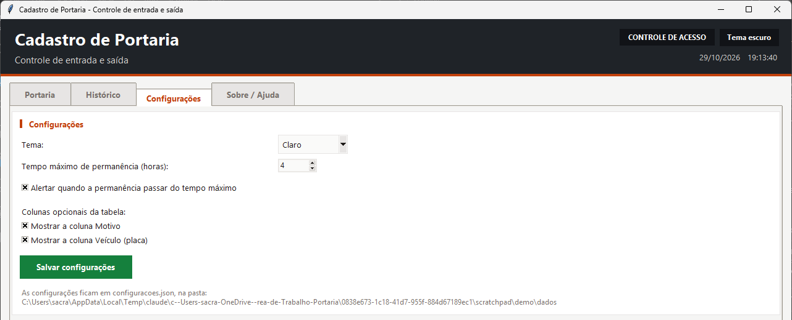
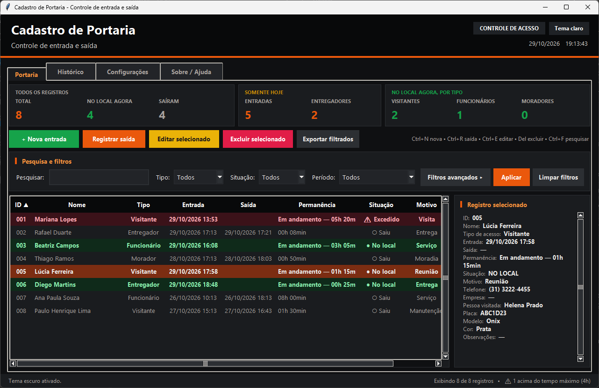
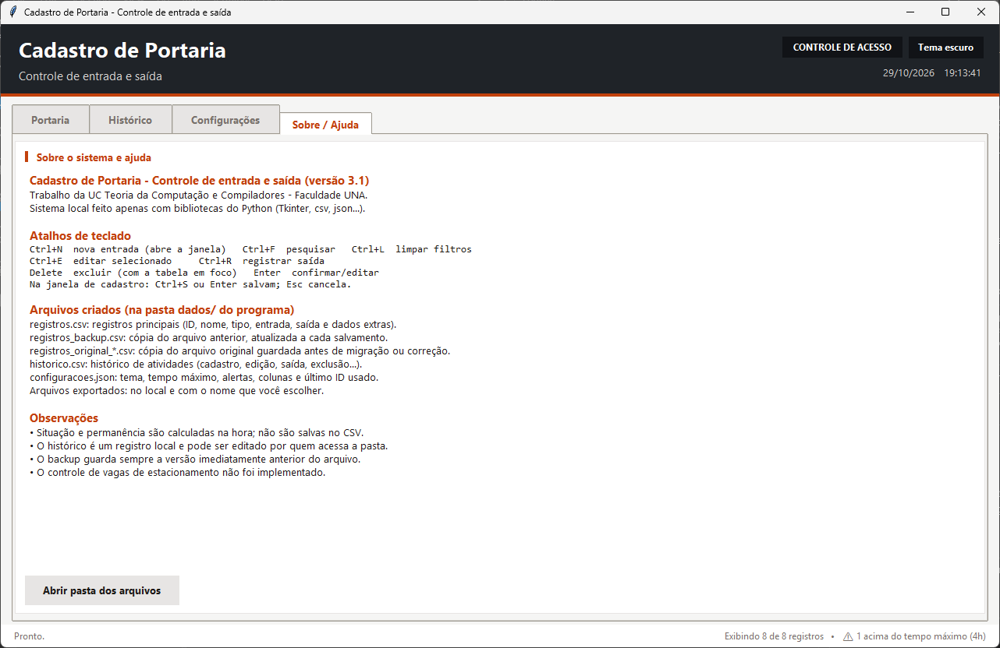

# Manual do Usuário

Este manual explica como abrir o **Cadastro de Portaria** e usar cada tela no
dia a dia da portaria. Para instalar o Python e resolver problemas de
execução, veja [Instalação e manutenção](instalacao_e_manutencao.md). As
regras completas de validação e cálculo estão em
[Regras de negócio](regras_de_negocio.md).

> As capturas de tela deste manual foram feitas com **dados fictícios**.

## Sumário

1. [Abrindo o sistema](#1-abrindo-o-sistema)
2. [Visão geral da janela](#2-visão-geral-da-janela)
3. [Registrar uma entrada](#3-registrar-uma-entrada)
4. [Registrar uma saída](#4-registrar-uma-saída)
5. [Editar um registro](#5-editar-um-registro)
6. [Excluir registros](#6-excluir-registros)
7. [Pesquisar e filtrar](#7-pesquisar-e-filtrar)
8. [Ordenar a tabela](#8-ordenar-a-tabela)
9. [Painel de indicadores](#9-painel-de-indicadores)
10. [Exportar para CSV](#10-exportar-para-csv)
11. [Aba Histórico](#11-aba-histórico)
12. [Aba Configurações](#12-aba-configurações)
13. [Aba Sobre / Ajuda](#13-aba-sobre--ajuda)
14. [Atalhos de teclado](#14-atalhos-de-teclado)
15. [Mensagens comuns](#15-mensagens-comuns)

---

## 1. Abrindo o sistema

Na pasta do projeto, execute:

```bash
python index.py
```

A janela principal abre na aba **Portaria**. Se o arquivo de registros
precisou de alguma correção ao ser carregado (por exemplo, uma linha
inválida), o sistema mostra um aviso explicando o que foi feito antes de
liberar a tela.

O sistema abre **uma única janela por vez**. Se ele já estiver aberto (às
vezes minimizado ou atrás de outras janelas), uma segunda tentativa mostra
o aviso "O sistema já está aberto em outra janela" e não abre outra cópia.
Isso impede que duas janelas apaguem as alterações uma da outra.

## 2. Visão geral da janela



| Área | O que mostra |
|------|--------------|
| **Cabeçalho** | Nome do sistema, botão de troca de tema e relógio (data e hora, atualizado a cada segundo). |
| **Abas** | Portaria, Histórico, Configurações e Sobre / Ajuda. |
| **Indicadores** | Três grupos de números (veja a [seção 9](#9-painel-de-indicadores)). |
| **Barra de ações** | Nova entrada, Registrar saída, Editar, Excluir e Exportar filtrados. |
| **Pesquisa e filtros** | Campo de pesquisa e listas de Tipo, Situação e Período; botão para filtros avançados. |
| **Tabela** | Um registro por linha. As cores indicam a situação. |
| **Registro selecionado** | Painel lateral com todos os dados da linha selecionada. |
| **Barra de status** | À esquerda, mensagens das últimas ações (somem após alguns segundos). À direita, quantos registros estão sendo exibidos e quantos passaram do tempo máximo. |

### Cores das linhas

| Cor | Situação |
|-----|----------|
| Verde, em negrito | **● No local**: a pessoa entrou e ainda não saiu. |
| Vermelho, em negrito | **⚠ Excedido**: está no local há mais tempo que o limite configurado (só aparece com o alerta ligado). |
| Cinza | **○ Saiu**: a saída já foi registrada. |

A coluna **Permanência** mostra o tempo total de quem já saiu (`01h 30min`) ou
o tempo decorrido até agora de quem ainda está no local
(`Em andamento — 05h 20min`). Esses tempos e as cores são atualizados
automaticamente a cada minuto.

As colunas **Motivo** e **Veículo** podem ser escondidas na aba
Configurações. Se a janela estiver estreita, use a barra de rolagem
horizontal abaixo da tabela.

### Rotina típica de um turno

| Momento | O que fazer |
|---------|-------------|
| Início do turno | Abra o sistema e confira o indicador **No local agora** e as linhas vermelhas (**⚠ Excedido**), que são pessoas que podem ter saído sem registro. |
| Chegada de alguém | `Ctrl+N`, digite o nome, escolha o tipo e pressione `Enter`. A entrada já vem com o horário atual. |
| Saída de alguém | `Ctrl+F`, digite parte do nome, `Enter` (vai para a tabela), selecione a pessoa e pressione `Ctrl+R`. |
| Saída esquecida | Selecione o registro, `Ctrl+E` e informe a hora real da saída. |
| Fim do turno | Filtre **Situação = No local** para conferir quem continua no local. Se for preciso, use **Exportar filtrados**. |

## 3. Registrar uma entrada

1. Clique em **+ Nova entrada** (ou pressione `Ctrl+N`).
2. A janela **Nova entrada** se abre por cima da principal. Enquanto ela
   estiver aberta, a janela principal não recebe cliques.
3. Preencha os campos principais:
   - **Nome da pessoa** (obrigatório): somente letras, espaço, hífen e
     apóstrofo. Números e símbolos são apagados enquanto você digita e
     aparece o aviso "Use apenas letras!".
   - **Tipo de acesso** (obrigatório): Visitante, Morador, Entregador ou
     Funcionário. Já vem com "Visitante".
   - **Motivo da entrada** (opcional): Visita, Entrega, Serviço, Reunião,
     Manutenção, Moradia ou Outro. A primeira opção da lista, em branco,
     desfaz a escolha.
   - **Data/hora de entrada** (obrigatória): já vem preenchida com o momento
     atual. Para mudar, digite **somente os números**; as barras, o espaço e
     os dois-pontos são colocados sozinhos. A dica abaixo do campo mostra
     quantos dígitos faltam e, ao completar, se a data é válida. Em vermelho,
     ela avisa se a data não existe, está no futuro ou é anterior a 2000.
   - **Data/hora de saída** (opcional): deixe em branco se a pessoa está
     entrando agora.
4. Para informar telefone, empresa, pessoa visitada, veículo ou observações,
   clique em **Informações adicionais ▸**.
5. Clique em **Cadastrar** (ou pressione `Enter` ou `Ctrl+S`).



Se algum dado estiver incorreto, o sistema mostra uma mensagem e coloca o
cursor no campo que precisa ser corrigido. Erros de significado (por
exemplo, uma data futura) aparecem como **Erro semântico**:



> Na imagem, a dica "Data/hora no futuro" já avisava o problema antes do
> clique. A conferência definitiva de todas as regras acontece ao clicar em
> **Cadastrar**.

Os campos **Empresa**, **Modelo** e **Observações** não podem começar com
`=`, `+`, `-` ou `@`. Essa é uma proteção de segurança: textos assim seriam
executados como fórmula se o arquivo fosse aberto no Excel. O telefone
precisa ter um **DDD existente**.

Se já houver um registro com o **mesmo nome, tipo e data/hora de entrada**,
o sistema pergunta se você deseja continuar mesmo assim.

Após o cadastro, a janela fecha, o novo registro fica selecionado na tabela
e recebe um número de **ID** automático (exibido com três dígitos, como
`009`).

**Outros botões da janela:**

- **Limpar**: apaga o que foi digitado e volta a entrada para o momento
  atual.
- **Cancelar**, `Esc` ou o **X** da janela: fecham sem salvar. Se houver
  dados digitados, o sistema pede confirmação.

## 4. Registrar uma saída

1. Selecione **uma** pessoa na tabela.
2. Clique em **Registrar saída** (ou `Ctrl+R`, ou botão direito → **Registrar
   saída**).

A data e a hora atuais são gravadas como saída, e a barra de status mostra a
permanência calculada. Se o registro já tiver saída, o sistema avisa e
orienta a usar **Editar selecionado** para corrigir o horário.

## 5. Editar um registro

1. Selecione **um** registro.
2. Clique em **Editar selecionado**, pressione `Ctrl+E` ou `Enter`, dê um
   **duplo clique** na linha ou use o botão direito → **Editar**.

A janela abre com o título **Editando registro #NNN** e borda amarela. Se o
registro tiver informações adicionais, essa parte já aparece aberta.



- **Salvar alterações** grava as mudanças. O ID não muda.
- **Restaurar** desfaz o que foi digitado e volta aos dados salvos.
- A edição é o caminho para **corrigir um horário de saída** ou informar uma
  saída em horário diferente do atual.

As mesmas validações do cadastro valem na edição.

## 6. Excluir registros

1. Selecione um ou mais registros. Para selecionar vários, use `Ctrl+clique`
   ou `Shift+clique`.
2. Clique em **Excluir selecionado**, pressione `Delete` (com a tabela em
   foco) ou use o botão direito → **Excluir**.
3. Confirme na mensagem, que lista os nomes selecionados.

A exclusão **não pode ser desfeita** pela interface. O histórico de
atividades do registro excluído é mantido, e o ID não é reaproveitado.

## 7. Pesquisar e filtrar



A tabela é atualizada enquanto você digita ou escolhe uma opção. Todos os
filtros são combinados: só aparecem os registros que atendem a todos ao
mesmo tempo.

| Filtro | Como funciona |
|--------|---------------|
| **Pesquisar** | Procura o texto em ID, nome, tipo, telefone, empresa, placa, pessoa visitada e motivo. Não diferencia maiúsculas, minúsculas nem acentos (`joao` encontra "João"). |
| **Tipo** | Todos, Visitante, Morador, Entregador ou Funcionário. |
| **Situação** | Todos, No local ou Saiu. Com o alerta de tempo máximo ligado, aparecem também **No prazo** e **Excedido**. |
| **Período** | Todos, Hoje, Ontem, Últimos 7 dias, Últimos 30 dias ou Período personalizado. Considera a **data de entrada**. |
| **De / Até** (avançado) | Datas do período personalizado (digite só os números). Preencher uma delas muda o Período para "Período personalizado". Pode-se usar só uma das duas. |
| **Motivo** (avançado) | Filtra por motivo. |
| **Empresa** (avançado) | Parte do nome da empresa. |

- **Filtros avançados ▸** mostra ou esconde a segunda linha de filtros.
- **Aplicar** confere se as datas do período personalizado são válidas e se a
  inicial não é posterior à final, e então atualiza a tabela.
- **Limpar filtros** (`Ctrl+L`) volta tudo ao padrão.
- `Ctrl+F` leva o cursor para o campo de pesquisa; `Enter` nesse campo leva o
  foco para a tabela.

Quando nenhum registro atende aos filtros, a tabela mostra uma mensagem
sugerindo **Limpar filtros**.

## 8. Ordenar a tabela

Clique no título de uma coluna para ordenar por ela. Clique de novo para
inverter a ordem. A seta ▲ (crescente) ou ▼ (decrescente) indica a coluna
usada. Datas são ordenadas pelo calendário e a permanência pela duração.

## 9. Painel de indicadores

Os números são calculados sobre **todos** os registros, independentemente
dos filtros da tabela.

| Grupo | Indicador | Significado |
|-------|-----------|-------------|
| Todos os registros | Total | Quantidade de registros cadastrados. |
| | No local agora | Registros sem saída. |
| | Saíram | Registros com saída. |
| Somente hoje | Entradas | Registros com data de entrada igual a hoje. |
| | Entregadores | Entradas de hoje do tipo Entregador. |
| No local agora, por tipo | Visitantes / Funcionários / Moradores | Pessoas sem saída, separadas por tipo. |

## 10. Exportar para CSV

- **Exportar filtrados** (aba Portaria) gera um CSV com os registros que
  estão aparecendo na tabela, incluindo as colunas calculadas Permanência e
  Situação (No local, Excedido ou Saiu). Para exportar tudo, clique antes em
  **Limpar filtros**.
- **Exportar** (aba Histórico) gera um CSV com os eventos que estão
  aparecendo no histórico.

O sistema sugere um nome com data e hora (por exemplo,
`registros_filtrados_20261029_1830.csv`) e abre na pasta `dados/`, mas você
pode escolher outro local. O arquivo usa `;` como separador e abre
diretamente no Excel. Não é permitido salvar por cima dos arquivos do
próprio sistema.

## 11. Aba Histórico



Lista as atividades realizadas no sistema, da mais recente para a mais
antiga: **Cadastro, Edição, Saída, Exclusão, Exportação e Configuração**.
Nas edições, a descrição informa quais campos foram alterados.

Filtros disponíveis: **Pesquisar** (nome, descrição, ID ou ação),
**Ação**, **De** e **Até** (data do evento). **Limpar** remove os filtros e
**Exportar** gera o CSV do que está sendo exibido. O total de eventos
exibidos aparece abaixo da tabela.

## 12. Aba Configurações



| Opção | Efeito |
|-------|--------|
| **Tema** | Claro ou Escuro. |
| **Tempo máximo de permanência (horas)** | Número inteiro de 1 a 72. Padrão: 4. |
| **Alertar quando a permanência passar do tempo máximo** | Liga ou desliga o destaque "⚠ Excedido" e as opções No prazo/Excedido do filtro. |
| **Mostrar a coluna Motivo** | Exibe ou esconde a coluna Motivo na tabela. |
| **Mostrar a coluna Veículo (placa)** | Exibe ou esconde a coluna Veículo na tabela. |

Clique em **Salvar configurações** (ou `Ctrl+S` com esta aba aberta). As
mudanças valem na hora e são lembradas na próxima vez que o sistema for
aberto. Abaixo do botão aparece a pasta onde o arquivo de configurações
fica.

O botão **Tema escuro / Tema claro** no cabeçalho também troca o tema e
salva a escolha imediatamente.



## 13. Aba Sobre / Ajuda



Mostra a versão do sistema, os atalhos de teclado, os arquivos criados e
observações de uso. O botão **Abrir pasta dos arquivos** abre a pasta
`dados/` no Explorador do Windows. Em outros sistemas, o caminho da pasta é
exibido em uma mensagem.

## 14. Atalhos de teclado

| Atalho | Onde | Ação |
|--------|------|------|
| `Ctrl+N` | Janela principal | Nova entrada |
| `Ctrl+F` | Janela principal | Ir para a pesquisa |
| `Ctrl+L` | Janela principal | Limpar filtros |
| `Ctrl+E` | Janela principal | Editar o selecionado |
| `Ctrl+R` | Janela principal | Registrar saída do selecionado |
| `Ctrl+S` | Aba Configurações | Salvar configurações |
| `Delete` | Tabela em foco | Excluir o(s) selecionado(s) |
| `Enter` | Tabela em foco | Editar o selecionado |
| `Enter` | Campo de pesquisa | Levar o foco para a tabela |
| `Enter` ou `Ctrl+S` | Janela de cadastro/edição | Salvar |
| `Esc` | Janela de cadastro/edição | Cancelar |
| Duplo clique | Linha da tabela | Editar |
| Botão direito | Linha da tabela | Menu: Editar, Registrar saída, Excluir |

## 15. Mensagens comuns

| Mensagem | O que fazer |
|----------|-------------|
| "Selecione uma pessoa que esteja dentro." / "Selecione um registro..." | Clique em uma linha da tabela antes da ação. |
| "Selecione apenas um registro..." | Editar e registrar saída funcionam com um registro por vez. |
| "Este registro já possui uma saída." | Use **Editar selecionado** para corrigir o horário. |
| "Possível duplicidade" | Confira se a pessoa já foi cadastrada. Confirme apenas se for realmente outro registro. |
| "Erro ao salvar ... A operação foi DESFEITA" | O arquivo de registros não pôde ser gravado. Feche o `registros.csv` se estiver aberto no Excel e tente de novo. |
| "Atenção ao carregar os registros" | O arquivo tinha problemas e foi corrigido; uma cópia do original foi guardada. Veja [Instalação e manutenção](instalacao_e_manutencao.md#7-solução-de-problemas). |
| "O sistema já está aberto em outra janela" | Procure a janela já aberta na barra de tarefas do Windows. |
| "O DDD NN não existe." | Confira os dois primeiros dígitos do telefone. |
| "... não pode começar com =, +, - ou @." | Reescreva o texto começando por uma letra ou número. |
| "Atenção: a última atividade não pôde ser gravada no histórico" (barra de status) | A operação foi salva, mas o evento ficou fora do histórico. Feche o `historico.csv` se estiver aberto em outro programa. |
| "Erro inesperado" | A ação não foi concluída, mas os dados já salvos não foram afetados. Anote o detalhe exibido e informe o responsável pelo sistema. |
