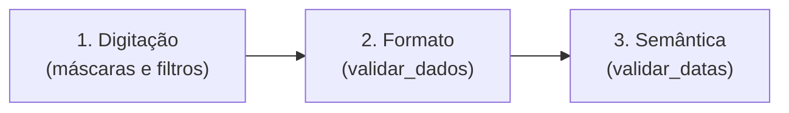
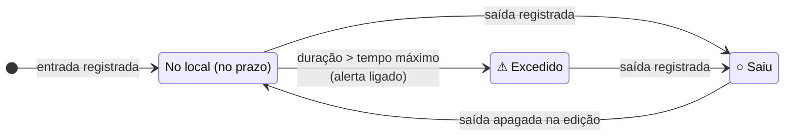

# Regras de Negócio

Este documento reúne as regras implementadas no **Cadastro de Portaria**:
validações, entrada e saída, permanência, alertas, filtros e carregamento de
arquivos. Cada regra indica onde está no código. Para o uso das telas, veja
o [Manual do usuário](manual_usuario.md).

## Sumário

1. [Conceitos](#1-conceitos)
2. [Campos do registro](#2-campos-do-registro)
3. [Validações](#3-validações)
4. [Regras de entrada e saída](#4-regras-de-entrada-e-saída)
5. [Cálculo de permanência](#5-cálculo-de-permanência)
6. [Situação e alerta de tempo máximo](#6-situação-e-alerta-de-tempo-máximo)
7. [Pesquisa, filtros e ordenação](#7-pesquisa-filtros-e-ordenação)
8. [Indicadores](#8-indicadores)
9. [Regras de carregamento do arquivo](#9-regras-de-carregamento-do-arquivo)
10. [Histórico de atividades](#10-histórico-de-atividades)
11. [Exportação](#11-exportação)
12. [Configurações](#12-configurações)

---

## 1. Conceitos

| Termo | Definição |
|-------|-----------|
| **Registro** | Uma passagem de uma pessoa pela portaria: uma entrada e, opcionalmente, uma saída. A mesma pessoa pode ter vários registros. |
| **No local** | Registro **sem** data/hora de saída. |
| **Saiu** | Registro **com** data/hora de saída. |
| **Permanência** | Tempo entre a entrada e a saída (ou até agora, para quem está no local). |
| **Excedido** | Pessoa no local há mais tempo que o tempo máximo configurado, com o alerta ligado. |

## 2. Campos do registro

| Campo | Obrigatório | Valores permitidos | Limite |
|-------|-------------|--------------------|--------|
| ID | automático | Inteiro positivo, único | — |
| Nome | **sim** | Letras (com acento), separadas por espaço, hífen ou apóstrofo | 2 a 60 caracteres |
| Tipo de acesso | **sim** | Visitante, Morador, Entregador, Funcionário | — |
| Motivo | não | Visita, Entrega, Serviço, Reunião, Manutenção, Moradia, Outro | — |
| Entrada | **sim** | `dd/mm/aaaa hh:mm` | — |
| Saída | não | `dd/mm/aaaa hh:mm` | — |
| Telefone | não | 10 ou 11 dígitos, com DDD existente | — |
| Empresa | não | Texto livre, sem começar com `=`, `+`, `-` ou `@` | 60 caracteres |
| Pessoa visitada | não | Mesmas regras do Nome | 2 a 60 caracteres |
| Placa | não | `ABC1234` (antiga) ou `ABC1D23` (Mercosul) | 7 caracteres |
| Modelo | não | Texto livre, sem começar com `=`, `+`, `-` ou `@` | 30 caracteres |
| Cor | não | Mesmas regras do Nome (só letras) | 20 caracteres |
| Observações | não | Texto livre, uma linha, sem começar com `=`, `+`, `-` ou `@` | 200 caracteres |

Fonte: [`nucleo/constantes.py`](../nucleo/constantes.py).

## 3. Validações

A validação acontece em **três níveis**:



### 3.1 Filtros e máscaras de digitação

Aplicados a cada tecla ([`interface/mascaras.py`](../interface/mascaras.py)).
O caractere não permitido é removido na hora.

| Campo | Comportamento |
|-------|---------------|
| Nome, Pessoa visitada | Remove números e símbolos; junta espaços repetidos; remove espaços no início; corta em 60 caracteres. No Nome, aparece o aviso "Use apenas letras!" ou "Máximo de 60 caracteres!". |
| Cor | Mesmas regras do nome, cortado em 20 caracteres. |
| Placa | Mantém só letras e números, converte para maiúsculas, corta em 7 caracteres. |
| Empresa, Modelo, Observações | Troca quebras de linha e tabulações por espaço; junta espaços repetidos; corta no limite do campo. |
| Entrada, Saída | Aceita só números (até 12) e insere `/`, espaço e `:` no formato `dd/mm/aaaa hh:mm`. A dica mostra "Faltam N dígito(s)", "Data/hora inexistente", "Data/hora no futuro", "Ano anterior a 2000" ou "Data/hora válida". As dicas antecipam as regras, mas a conferência definitiva é feita ao salvar. |
| Telefone | Aceita só números (até 11) e formata como `(DD) NNNN-NNNN` ou `(DD) NNNNN-NNNN`. |
| Datas dos filtros (De/Até) | Aceita só números (até 8) no formato `dd/mm/aaaa`. |

Se a máscara estiver cheia e um número for digitado no meio, ele
**substitui** o dígito seguinte em vez de empurrar os demais.

### 3.2 Validação de formato

Executada ao salvar, por `validar_dados()` em
[`nucleo/validacoes.py`](../nucleo/validacoes.py). Antes de validar, todos
os campos têm espaços repetidos e espaços nas pontas removidos. As
verificações são feitas **nesta ordem**, e a primeira falha interrompe a
validação:

| # | Campo | Regra | Mensagem |
|---|-------|-------|----------|
| 1 | Nome | Não vazio | "O nome não pode ficar vazio." |
| 2 | Nome | Pelo menos 2 caracteres | "O nome é muito curto. Digite o nome completo." |
| 3 | Nome | No máximo 60 caracteres | "O nome deve ter no máximo 60 caracteres." |
| 4 | Nome | Só letras, separadas por um espaço, hífen ou apóstrofo | "O nome não pode conter números ou símbolos." |
| 5 | Tipo | Um dos quatro tipos | "Selecione um tipo de acesso válido..." |
| 6 | Motivo | Vazio ou um dos motivos da lista | "Selecione um motivo da lista ou deixe em branco." |
| 7 | Entrada | Não vazia | "Informe a data e hora da entrada." |
| 8 | Entrada | Data/hora existente no formato `dd/mm/aaaa hh:mm` | "Entrada em formato inválido." |
| 9 | Saída | Vazia ou data/hora existente | "Saída em formato inválido." |
| 10–13 | Datas | Regras semânticas (veja 3.3) | "Erro semântico: ..." |
| 14 | Telefone | Vazio, ou 10/11 dígitos | "O telefone deve ter 10 ou 11 dígitos, com DDD." |
| 15 | Telefone | DDD existente no Brasil (67 DDDs do plano de numeração da Anatel, em `DDDS_VALIDOS`) | "O DDD NN não existe." |
| 16 | Telefone | Com 11 dígitos, o 3º dígito é 9 | "Telefone com 11 dígitos deve começar com 9 depois do DDD." |
| 17 | Pessoa visitada | Se preenchida, regras 2 a 4 do Nome | "O nome da pessoa visitada ..." |
| 18 | Placa | Se preenchida (após remover hífen e converter para maiúsculas): 3 letras, 1 número, 1 letra ou número, 2 números | "Use o formato ABC1234 ou ABC1D23..." |
| 19 | Cor | Se preenchida, só letras | "A cor deve conter apenas letras." |
| 20 | Empresa, Modelo, Cor, Observações | Dentro do limite de tamanho | "...: máximo de N caracteres." |
| 21 | Empresa, Modelo, Observações | Não começar com `=`, `+`, `-`, `@`, tabulação ou retorno de carro (veja 3.5) | "... não pode começar com =, +, - ou @." |

Ao encontrar um erro, a interface mostra a mensagem, abre as "Informações
adicionais" se o campo estiver lá e coloca o cursor no campo.

**Normalizações aplicadas aos dados salvos:**

- Datas gravadas sempre com dois dígitos (`1/10/2026 9:05` → `01/10/2026 09:05`).
- Telefone gravado formatado (`31987654321` → `(31) 98765-4321`).
- Placa gravada em maiúsculas e sem hífen (`abc-1234` → `ABC1234`). Na tela e
  na exportação, placas no padrão antigo aparecem com hífen (`ABC-1234`).
- Letras maiúsculas e minúsculas do nome **não** são alteradas.

### 3.3 Regras semânticas das datas

O formato pode estar correto e mesmo assim o dado não fazer sentido para uma
portaria. Implementado em `validar_datas()`:

| Regra | Descrição | Mensagem |
|-------|-----------|----------|
| RS1 | A entrada não pode ser posterior ao momento atual. | "A entrada não pode ser uma data/hora futura." |
| RS2 | A entrada não pode ser anterior ao ano 2000. | "A entrada não pode ser anterior ao ano 2000." |
| RS3 | A saída, se informada, não pode ser posterior ao momento atual. | "A saída não pode ser uma data/hora futura." |
| RS4 | A saída não pode ser anterior à entrada. | "A saída não pode ser anterior à entrada." |

Saída **igual** à entrada é permitida (permanência zero, por exemplo, uma
entrega rápida). As datas digitadas têm precisão de minuto; o momento atual
usado na comparação inclui os segundos.

### 3.4 Possível duplicidade

Ao cadastrar ou editar, se já existir **outro** registro com o mesmo nome
(sem diferenciar maiúsculas e minúsculas), o mesmo tipo e a mesma data/hora
de entrada, o sistema pergunta se deseja continuar. Não é um bloqueio: a
mesma pessoa pode entrar várias vezes. Fonte: `existe_duplicado()`.

### 3.5 Proteção contra injeção de fórmulas (CSV injection)

Um texto que começa com `=`, `+`, `-` ou `@` é interpretado como **fórmula**
quando um CSV é aberto no Excel. Um texto malicioso, como
`=HYPERLINK("http://site","clique")`, poderia então executar uma ação ao
abrir o arquivo. Por isso, há duas barreiras:

1. **Na entrada (regra 21):** Empresa, Modelo e Observações não podem
   começar com esses caracteres. Nome, Pessoa visitada, Cor, Placa, Telefone
   e datas já não os aceitam por causa de seus formatos.
2. **Na exportação (EX5):** qualquer valor exportado que comece com esses
   caracteres recebe um apóstrofo no início, inclusive dados antigos ou
   editados manualmente no arquivo.

Um hífen **no meio** do texto continua permitido (por exemplo,
"Entrega - caixa grande").

## 4. Regras de entrada e saída

| Regra | Descrição | Fonte |
|-------|-----------|-------|
| RE1 | Todo cadastro recebe o próximo ID disponível. Os IDs só aumentam e não são reaproveitados após exclusões. O próximo ID é guardado em `configuracoes.json` e, ao abrir, também é conferido com os IDs citados no histórico. Assim, mesmo sem o `configuracoes.json`, um ID excluído não volta a ser usado. | `operacao_cadastrar()`, `carregar_registros()` |
| RE2 | No cadastro, a entrada vem preenchida com o momento atual e o tipo com "Visitante". | `limpar_formulario()` |
| RE3 | Um cadastro pode já incluir a saída (registro de uma visita passada). | `validar_dados()` |
| RE4 | **Registrar saída** grava o momento atual como saída e só é permitido para registros sem saída. | `operacao_registrar_saida()` |
| RE5 | Registrar saída e editar funcionam com **um** registro selecionado. | `interface/acoes.py`, `formulario.py` |
| RE6 | Para alterar ou remover uma saída já registrada, é preciso editar o registro. | `registrar_saida()` |
| RE7 | Na edição, o ID não muda e todas as validações do cadastro se aplicam. | `operacao_editar()` |
| RE8 | A exclusão aceita vários registros de uma vez e exige confirmação. | `excluir()` |
| RE9 | Se a gravação do arquivo falhar, a operação é desfeita na memória e nada é alterado. | `aplicar_e_salvar()` |
| RE10 | Toda operação concluída com sucesso gera um evento no histórico. Se o evento não puder ser gravado, a barra de status avisa o usuário. | `operacoes.py`, `atualizar_historico()` |
| RE11 | Só uma cópia do sistema pode ficar aberta por vez no mesmo computador e pasta de dados. A segunda cópia mostra um aviso e não abre. | `obter_trava()` |

## 5. Cálculo de permanência

Implementado em [`nucleo/calculos.py`](../nucleo/calculos.py).

```
duração = saída − entrada              (se houver saída)
duração = momento atual − entrada      (se ainda estiver no local)
```

- O resultado é exibido como `HHh MMmin`, com os minutos **arredondados para
  baixo** (por exemplo, 1 h 35 min 50 s → `01h 35min`). Durações acima de 99
  horas aparecem com mais dígitos (`120h 00min`).
- Para quem está no local, o texto é `Em andamento — HHh MMmin`.
- O cálculo **nunca altera** nem inventa a saída: o tempo "em andamento" é
  apenas exibido.
- Se a duração for negativa (por exemplo, o relógio do computador foi
  atrasado depois da entrada), é exibido `Em andamento` sem tempo, ou `—`
  para quem saiu.
- A permanência é recalculada ao redesenhar a tabela e a cada 60 segundos.
- A permanência não é gravada em `registros.csv`. Ela aparece na
  exportação e na descrição do evento "Saída" do histórico.

**Exemplos:**

| Entrada | Saída | Agora | Permanência |
|---------|-------|-------|-------------|
| 29/10/2026 09:30 | 29/10/2026 11:05 | — | `01h 35min` |
| 29/10/2026 10:00 | 29/10/2026 10:00 | — | `00h 00min` |
| 29/10/2026 14:00 | (vazia) | 29/10/2026 18:00 | `Em andamento — 04h 00min` |
| 28/10/2026 22:00 | 29/10/2026 06:15 | — | `08h 15min` |

## 6. Situação e alerta de tempo máximo



| Regra | Descrição |
|-------|-----------|
| AL1 | Situação **No local** = sem saída; **Saiu** = com saída. |
| AL2 | Um registro está **Excedido** quando o alerta está ligado, a pessoa está no local e a duração, em **minutos inteiros**, é **estritamente maior** que o tempo máximo. Com limite de 4 h: `04h 00min` (inclusive 4h00min59s) **não** é excedido; `04h 01min` é. A regra usa a mesma precisão exibida na tela. |
| AL3 | Quem já saiu nunca é marcado como excedido, mesmo que a permanência tenha passado do limite. |
| AL4 | O tempo máximo é um número inteiro de horas entre 1 e 72 (padrão: 4). |
| AL5 | Com o alerta desligado, ninguém é marcado como excedido e o filtro de situação mostra só Todos, No local e Saiu. |
| AL6 | Registros excedidos aparecem em vermelho com "⚠ Excedido"; o painel de detalhes mostra "⚠ Tempo máximo (Nh) excedido"; a barra de status mostra quantos estão acima do limite. |
| AL7 | Na exportação, a coluna Situação traz o mesmo que a tela, sem símbolos: "No local", "Excedido" ou "Saiu". |
| AL8 | Com o filtro de situação em "No prazo" ou "Excedido", a tabela é refiltrada a cada minuto, para que um registro que passou do limite troque de grupo sem ação do usuário. |

## 7. Pesquisa, filtros e ordenação

Implementado em [`nucleo/consultas.py`](../nucleo/consultas.py).

### 7.1 Combinação

Um registro aparece na tabela somente se atender a **todos** os filtros
preenchidos (operação "E").

### 7.2 Pesquisa por texto

- Procura o texto digitado como **parte** de qualquer um destes campos: ID
  (com e sem zeros à esquerda, como `7` e `007`), nome, tipo, telefone
  (formatado e só dígitos), empresa, placa (com e sem hífen), pessoa visitada
  e motivo.
- Não diferencia maiúsculas, minúsculas nem acentos.
- **Não** pesquisa em observações, modelo e cor do veículo.
- Espaços nas pontas do texto pesquisado são ignorados.

### 7.3 Filtros

| Filtro | Regra |
|--------|-------|
| Tipo | Igualdade exata com o tipo do registro. |
| Situação: No local | Sem saída (inclui excedidos). |
| Situação: Saiu | Com saída. |
| Situação: No prazo | Sem saída e não excedido (só com alerta ligado). |
| Situação: Excedido | Excedido (só com alerta ligado). |
| Motivo | Igualdade exata. |
| Empresa | Texto contido no nome da empresa, sem diferenciar maiúsculas e acentos. |

### 7.4 Períodos

Sempre comparados com a **data de entrada** (a hora é ignorada) e com
limites **inclusivos**.

| Período | Intervalo (sendo *H* a data de hoje) |
|---------|---------------------------------------|
| Todos | Sem restrição. |
| Hoje | *H* a *H*. |
| Ontem | *H*−1 a *H*−1. |
| Últimos 7 dias | *H*−6 a *H* (hoje e os 6 dias anteriores). |
| Últimos 30 dias | *H*−29 a *H*. |
| Período personalizado | De *De* até *Até*. Qualquer uma das pontas pode ficar em branco (aberta). |

Regras de interface ligadas ao período
([`interface/filtros.py`](../interface/filtros.py)):

- Escolher um período pronto apaga as datas De/Até.
- Escolher "Período personalizado" abre os filtros avançados.
- Digitar uma data em De ou Até muda o período para "Período personalizado".
- Enquanto a data está incompleta ou é inexistente, aquela ponta é tratada
  como aberta.
- O botão **Aplicar** recusa data inicial posterior à final e datas
  inválidas. Sem clicar em Aplicar, um intervalo invertido simplesmente não
  mostra registros.
- Na virada do dia, a tabela é refiltrada automaticamente para que "Hoje" e
  "Ontem" continuem corretos.

### 7.5 Ordenação

| Coluna | Critério |
|--------|----------|
| ID | Numérico. |
| Nome, Tipo, Motivo | Alfabético, sem diferenciar maiúsculas e acentos. |
| Entrada | Cronológico. |
| Saída | Cronológico; registros sem saída ficam no fim na ordem crescente. |
| Permanência | Pela duração. |
| Situação | Alfabética pelo texto "No local" / "Saiu". |
| Veículo | Pela placa. |

A ordenação padrão é por ID crescente.

## 8. Indicadores

Calculados por `calcular_indicadores()` sobre **todos** os registros (os
filtros da tabela não interferem).

| Indicador | Regra |
|-----------|-------|
| Total | Quantidade de registros. |
| No local agora | Registros sem saída. |
| Saíram | Registros com saída. |
| Entradas (hoje) | Registros cuja data de entrada é hoje (independe de já terem saído). |
| Entregadores (hoje) | Entradas de hoje com tipo Entregador. |
| Visitantes / Funcionários / Moradores | Registros sem saída com o respectivo tipo. Entregadores no local entram apenas em "No local agora". |

## 9. Regras de carregamento do arquivo

Ao iniciar, `carregar_registros()`
([`nucleo/persistencia.py`](../nucleo/persistencia.py)) aplica estas regras
ao `registros.csv`:

| Regra | Descrição |
|-------|-----------|
| CA1 | Lê em UTF-8 (com ou sem BOM); se falhar, tenta CP-1252 (padrão antigo do Excel no Windows). |
| CA2 | Se a primeira célula for "ID", as colunas são identificadas pelo título, aceitando títulos sem acento e nomes antigos ("Tipo", "Pessoa a visitar", "Observacao"). Colunas desconhecidas são descartadas com aviso. |
| CA3 | Sem cabeçalho, o formato é deduzido: 5 ou mais colunas com número na primeira → formato com ID; 4 colunas com tipo válido na terceira → ID, nome, tipo, entrada; outras 4 colunas → nome, tipo, entrada, saída (formato mais antigo). Linhas em qualquer outro formato são ignoradas com o aviso "dados incompletos". |
| CA4 | Cada linha precisa de nome não vazio, tipo válido, entrada válida e, se houver saída, saída válida e não anterior à entrada. Linhas que falham são **ignoradas** com aviso indicando o número da linha. |
| CA4a | Antes da validação, o tipo é corrigido quando difere só em acentos ou maiúsculas (`funcionario` → `Funcionário`). Isso evita descartar linhas salvas pelo Excel ou digitadas sem acento. |
| CA5 | Datas são padronizadas para `dd/mm/aaaa hh:mm`. |
| CA6 | IDs válidos e únicos são mantidos. IDs vazios, inválidos ou repetidos recebem um novo ID, acima do maior existente. |
| CA7 | O próximo ID é o maior entre: o valor salvo em `configuracoes.json`, o maior ID do arquivo + 1 e o maior ID citado no histórico + 1. |
| CA8 | Se houve migração, padronização, novo ID ou linha ignorada, o arquivo original é copiado para `registros_original_AAAAMMDD_HHMMSS.csv` **antes** de ser regravado no formato atual. Se a cópia não puder ser feita, o arquivo não é regravado naquele momento. |
| CA9 | Se o arquivo não puder ser lido, o sistema inicia vazio, guarda uma cópia do original e avisa. O programa nunca fecha por causa do arquivo. |
| CA10 | São exibidos até 8 avisos; os demais são resumidos em "... e mais N aviso(s)". |

> As regras de carregamento são menos rígidas que as do formulário. Um
> arquivo editado manualmente pode conter, por exemplo, datas futuras ou
> nomes com números, que serão aceitos na leitura. Veja
> [Segurança e limitações](seguranca_e_limitacoes.md).

## 10. Histórico de atividades

| Ação | Quando é registrada | Descrição gerada |
|------|---------------------|------------------|
| Cadastro | Após cadastrar | `Entrada registrada (Tipo) em dd/mm/aaaa hh:mm` |
| Edição | Após salvar uma edição | `Campos alterados: ...` ou `Nenhum campo foi alterado` |
| Saída | Após registrar saída pelo botão | `Saída registrada em ... (permanência HHh MMmin)` |
| Exclusão | Para cada registro excluído | `Registro excluído (Tipo, entrada ...)` |
| Exportação | Após exportar | `Descrição: N linha(s) → arquivo.csv` |
| Configuração | Ao salvar configurações com alguma mudança, ou ao trocar o tema pelo cabeçalho | Lista das mudanças, como `tempo_max_horas: 4 → 6` |

- Os eventos são apenas acrescentados ao arquivo; nenhum evento é removido
  pelo sistema, nem quando o registro é excluído.
- A data/hora do evento tem precisão de segundos.
- Uma saída informada pela **edição** gera um evento "Edição" (com "Saída"
  entre os campos alterados), não um evento "Saída".
- Filtros da aba: texto (em nome, descrição, ID e ação), ação e intervalo de
  datas do evento (inclusivo).

## 11. Exportação

| Regra | Descrição |
|-------|-----------|
| EX1 | "Exportar filtrados" exporta exatamente os registros que atendem aos filtros atuais da aba Portaria. |
| EX2 | "Exportar" do histórico exporta os eventos que atendem aos filtros da aba Histórico. |
| EX3 | Se não houver dados, a exportação não é feita e o usuário é avisado. |
| EX4 | O arquivo usa separador `;` e codificação UTF-8 com BOM. |
| EX5 | Valores que começam com `=`, `+`, `-`, `@`, tabulação ou retorno de carro recebem um apóstrofo no início, para o Excel não interpretá-los como fórmula. |
| EX6 | Não é permitido exportar por cima de `registros.csv`, `registros_backup.csv`, `historico.csv`, `configuracoes.json`, `portaria.lock`, arquivos `*.tmp` ou `registros_original_*.csv` da pasta `dados/` (sem diferenciar maiúsculas e minúsculas). |
| EX7 | A exportação de registros inclui as colunas calculadas Permanência e Situação (com "Excedido"), e a placa formatada. |

Colunas exportadas (registros): ID, Nome, Tipo de acesso, Entrada, Saída,
Permanência, Situação, Motivo, Telefone, Empresa, Pessoa visitada, Placa,
Modelo, Cor, Observações.

## 12. Configurações

| Regra | Descrição |
|-------|-----------|
| CF1 | O tempo máximo deve ser um inteiro entre 1 e 72; caso contrário, a configuração não é salva e aparece um aviso. |
| CF2 | As configurações passam a valer imediatamente (tema, colunas, alerta, opções do filtro de situação). |
| CF3 | Se o filtro de situação estiver em "No prazo" ou "Excedido" e o alerta for desligado, o filtro volta para "Todos". |
| CF4 | Ao carregar, valores com tipo errado ou fora da faixa são substituídos pelo padrão; tema desconhecido vira "claro"; arquivo ausente ou inválido usa todos os padrões. |
| CF5 | Se o arquivo de configurações não puder ser gravado, as mudanças valem só até fechar o programa, e o usuário é avisado. |
